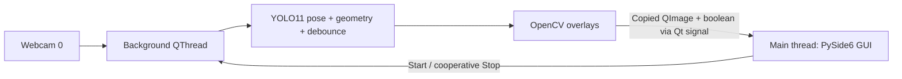

<div align="center">

# VERTEBRATE
### Live pose. Clear signals. Local execution.


[](LICENSE)

A focused webcam application that turns human pose geometry into visible fall-posture alerts.

</div>

---

## One entry point. Two threads. A live view.

`app.py` starts the application; implementation is organized under `app_modules/` so each class and shared helper can be found directly. The runtime behavior and interface are unchanged. `app.py` provides a dark control-room interface: green/red skeleton overlays
on a live view, a status sidebar (fall-evidence meter, people in view, frame
rate, falls today, location, alarm setting), a live location/time watermark,
and banners that escalate from **Fall detected** to a pulsing **Emergency
alarm**. It looks the same on Windows and macOS. Inference runs
locally on the CPU. The application does not upload or record webcam footage.

### Code map

- `app.py` — executable entry point.
- `app_modules/mainwindow.py` — connects the interface, camera, location, fall log, and alarm.
- `app_modules/camerathread.py`, `locationfeed.py`, `falllog.py`, and `alarmsound.py` — background camera, location, logging, and alarm components.
- `app_modules/debounce.py`, `falllogdialog.py`, and the UI component modules (`videoview.py`, `evidencemeter.py`, `stattile.py`, `logomark.py`) — focused behavior and widgets.
- `app_modules/common.py` — shared settings, constants, Qt imports, and helper functions.



The worker owns the camera and model; the main thread owns every widget.
Only one frame signal may be pending, preventing an image backlog.
Camera release happens in the worker during shutdown.

## The heuristic

Each detected person matches when either condition holds:

```text
width / height > 1.2
              OR
(shoulder_5.y + shoulder_6.y) / 2 > (hip_11.y + hip_12.y) / 2 + 20 pixels
```

Image Y increases downward. Missing/zeroed spine landmarks disable the spine
check; the bounding-box check remains available. Red overlays indicate matching
posture; green indicates the rule did not match.

The alert requires **five consecutive processed frames** with at least one
matching person. A nonmatching frame clears the counter. This scene-wide
debounce does not establish person identity or a fixed duration in seconds.
There are no historical baselines, ByteTrack IDs, or legacy state machines.

## Quickstart · Windows 11 x64 or macOS

Use **Python 3.12** and a webcam. From the repository directory:

```powershell
# Windows
py -3.12 -m venv .venv
.\.venv\Scripts\python.exe -m pip install -r requirements.txt
.\.venv\Scripts\python.exe -m pip check
```

```bash
# macOS
python3.12 -m venv .venv
.venv/bin/python -m pip install -r requirements_macOS.txt
.venv/bin/python -m pip check
```

Keep an existing working `.venv` if you already have one. Install only the listed
OpenCV distribution; do not add headless or contrib variants alongside it.

Place `yolo11n-pose.pt` beside `app.py` or inside `models/`. For a fresh setup,
download the [official weights](https://github.com/ultralytics/assets/releases/download/v8.3.0/yolo11n-pose.pt)
once and save them in either location. Missing weights are never downloaded
automatically. Prepare dependencies and weights before offline use.

```powershell
.\.venv\Scripts\python.exe app.py      # Windows
.venv/bin/python app.py                # macOS
```

Click **Start monitoring**. Click **Stop** to release it. If camera 0 cannot open,
close other camera applications and allow camera access (Windows: *Settings >
Privacy & security > Camera*; macOS: *System Settings > Privacy & Security >
Camera* for your terminal or editor). A stalled driver is reported while the
window remains responsive.

### Location watermark

The video shows coordinates, accuracy, date/time and the source. A connected
GPS receiver (USB, serial or Bluetooth, NMEA output) is used first; otherwise
the OS location service, which uses the device's GPS chip if it has one and
Wi-Fi positioning if not. Allow location access when asked. To pick a receiver
manually set `VERTEBRATE_GPS_PORT` (e.g. `COM4` or `/dev/cu.usbmodem1101`), or
set it to `off` to ignore receivers.

### Fall log

Every confirmed alert is logged with the date and time it was detected, when
it ended, how long it lasted, the location, and why it ended (posture cleared,
camera stopped, error, app closed). Click **Fall log** to see this device's
history; a fall happening now appears live at the top. Each computer keeps its
own file, `runtime/logs/falls/<device-name>.csv`, which opens in Excel or
Numbers. No images or video are saved.

### Emergency alarm

In the sidebar's **Emergency alarm** card, set **Ring if fallen for** to the number of seconds a person may
stay fallen before a loud siren rings on this device; choose **Off** (0) to
disable it. The setting is remembered. While a fall is detected the banner
counts down; when the alarm rings, the window comes to the front and a
**Silence alarm** button appears. The alarm stops on its own when the person
gets up, and ring/silence times are added to the fall log. Keep the device's
volume up: the app cannot override a muted speaker. The alarm sounds only on
this device; nobody is contacted.

## Workspace after cleanup

```text
app.py                       Standalone application
requirements.txt             V1 CPU dependencies
requirements-win-cpu.lock    Preserved historical full environment lock
LICENSE                      MIT grant for original code
THIRD_PARTY_NOTICES.md        Dependency and model license scope
models/                      Local weights and provenance
data/videos/                 Preserved local footage; Git-ignored
runtime/                     Generated local settings; Git-ignored
.archive/                    Legacy backups; Git-ignored
```

`requirements.txt` is the V1 installation path. The historical lock includes
legacy/test packages and remains available for reproducing the old environment.
Weights and videos stay on disk and are excluded from new Git commits.

## Interpretation

This detects posture, not its cause. Deliberately lying down, camera rotation,
occlusion, and pose errors can affect alerts. The 20-pixel threshold depends on
image scale. Development observations are not an independently validated
accuracy guarantee.

**Local demo — no external emergency dispatch.**

## License

Original project code: **MIT**, copyright **Advaet Chintakunta**. See [LICENSE](LICENSE).

Ultralytics software and weights have separate **AGPL-3.0** terms. The MIT grant
does not relicense them or make the combined application MIT-only. Ultralytics
describes AGPL requirements for the combined project or a separate enterprise
license in its [licensing guidance](https://www.ultralytics.com/license).
Retain applicable upstream notices. See [third-party notices](THIRD_PARTY_NOTICES.md).
