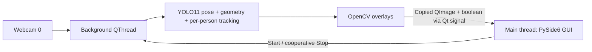

<div align="center">

# VERTEBRATE
### Live pose. Clear signals. Local execution.


[](LICENSE)

A focused webcam application that turns human pose geometry into visible fall-posture alerts.

</div>

---

## One entry point. Two threads. A live view.

`app.py` starts the application; implementation is organized under `app_modules/` so each class and shared helper can be found directly. The runtime behavior and interface are unchanged. `app.py` provides a dark control-room interface: green/red skeleton overlays
on a live view, a status sidebar (urgency meter, people in view, frame
rate, falls today, location, alarm setting), a live location/time watermark,
and banners that escalate from **Fall detected** to a pulsing **Emergency
alarm**. It looks the same on Windows and macOS. Inference runs
locally on the CPU. The application does not upload or record webcam footage;
the only optional network use is a text alert to caregivers on Discord.

### Code map

- `app.py` — executable entry point.
- `app_modules/mainwindow.py` — connects the interface, camera, location, fall log, and alarm.
- `app_modules/camerathread.py`, `locationfeed.py`, `falllog.py`, and `alarmsound.py` — background camera, location, logging, and alarm components.
- `app_modules/caregivers.py` — optional Discord caregiver alerts: sender, message format and setup window.
- `app_modules/tracking.py` — per-person tracking (`PersonTracker`): IDs and each person's 5-frame fall check.
- `app_modules/fallanalysis.py` — fall analysis: each person's last 8 s of keypoints (`PoseHistory`, measured in torso lengths so near and far people compare) and the detector's real frame rate (`FrameRateMeter`), movement after a fall, people around, sudden vs gradual and the priority of each fall.
- `app_modules/falllogdialog.py` and the UI component modules (`videoview.py`, `urgencymeter.py`, `stattile.py`, `logomark.py`) — focused behavior and widgets.
- `app_modules/common.py` — shared settings, constants, Qt imports, and helper functions.



The worker owns the camera and model; the main thread owns every widget.
Only one frame signal may be pending, preventing an image backlog.
Camera release happens in the worker during shutdown.

## The heuristic

Each detected person matches when either condition holds:

```text
width / height > 1.2
              OR
(shoulder_5.y + shoulder_6.y) / 2 > (hip_11.y + hip_12.y) / 2 + 20 pixels
```

Image Y increases downward. Missing/zeroed spine landmarks disable the spine
check; the bounding-box check remains available. Red overlays indicate matching
posture; green indicates the rule did not match.

A fall is confirmed **per person**: a small built-in tracker gives each person
an ID (`#1`, `#2`, …) that follows them from frame to frame, and the alert needs
**five consecutive processed frames in which that same person** matches. A
normal frame for that person resets their count; fallen frames from different
people never add up. Each box on the video shows its ID and progress, e.g.
`#2 Fallen posture 3/5`, then `#2 FALL CONFIRMED`. The fall log and the Discord
alerts name the person (IDs restart when the camera restarts). Five frames are
not a fixed duration in seconds. The tracker uses NumPy only — no extra packages.

## Quickstart · Windows 11 x64 or macOS

Use **Python 3.12** and a webcam. From the repository directory:

```powershell
# Windows
py -3.12 -m venv .venv
.\.venv\Scripts\python.exe -m pip install -r requirements.txt
.\.venv\Scripts\python.exe -m pip check
```

```bash
# macOS
python3.12 -m venv .venv
.venv/bin/python -m pip install -r requirements_macOS.txt
.venv/bin/python -m pip check
```

Keep an existing working `.venv` if you already have one. Install only the listed
OpenCV distribution; do not add headless or contrib variants alongside it.

Place `yolo11n-pose.pt` beside `app.py` or inside `models/`. For a fresh setup,
download the [official weights](https://github.com/ultralytics/assets/releases/download/v8.3.0/yolo11n-pose.pt)
once and save them in either location. Missing weights are never downloaded
automatically. Prepare dependencies and weights before offline use.

```powershell
.\.venv\Scripts\python.exe app.py      # Windows
.venv/bin/python app.py                # macOS
```

Click **Start monitoring**. Click **Stop** to release it. If camera 0 cannot open,
close other camera applications and allow camera access (Windows: *Settings >
Privacy & security > Camera*; macOS: *System Settings > Privacy & Security >
Camera* for your terminal or editor). A stalled driver is reported while the
window remains responsive.

### Location watermark

The video shows coordinates, accuracy, date/time and the source. A connected
GPS receiver (USB, serial or Bluetooth, NMEA output) is used first; otherwise
the OS location service, which uses the device's GPS chip if it has one and
Wi-Fi positioning if not. Allow location access when asked. To pick a receiver
manually set `VERTEBRATE_GPS_PORT` (e.g. `COM4` or `/dev/cu.usbmodem1101`), or
set it to `off` to ignore receivers.

### Fall log

Every confirmed alert is logged with the date and time it was detected, when
it ended, how long it lasted, the location, and why it ended (posture cleared,
camera stopped, error, app closed). Click **Fall log** to see this device's
history; a fall happening now appears live at the top. Each computer keeps its
own file, `runtime/logs/falls/<device-name>.csv`, which opens in Excel or
Numbers. No images or video are saved.

**Clearing the log:** the Fall log window's **Clear log…** button removes all
recorded falls from the list after you confirm (Cancel is the default). The old
file is not deleted: it is moved to `runtime/logs/falls/cleared/` with the date
and time in its name, so it can be restored by moving it back. A fall that is
being detected at that moment is not affected and is logged when it ends.

### Emergency alarm

In the sidebar's **Emergency alarm** card, set **Ring if fallen for** to the number of seconds a person may
stay fallen before a loud siren rings on this device; choose **Off** (0) to
disable it. The setting is remembered. While a fall is detected the banner
counts down; when the alarm rings, the window comes to the front and a
**Silence alarm** button appears. The alarm stops on its own when the person
gets up, and ring/silence times are added to the fall log. Keep the device's
volume up: the app cannot override a muted speaker. The siren sounds only on
this device; to also reach people elsewhere, set up caregiver alerts.

### Caregiver alerts (Discord)

The app can post to a Discord channel when a fall is detected, when the alarm
rings and when the fall ends. Each message names the person (`#2`), gives the time, how long they
have been down and the location with a Google Maps link. No images or video are
ever sent.

1. In Discord, make a channel for the caregivers (or use an existing one).
2. Choose how to connect:
   - **Webhook (simplest):** channel ⚙ *Edit Channel › Integrations › Webhooks ›
     New Webhook › Copy Webhook URL*.
   - **Bot:** in the Discord Developer Portal create an application, add a bot,
     copy its token, and invite it with *Send Messages* and *Embed Links*. Turn
     on Developer Mode in Discord, right-click the channel › *Copy Channel ID*.
3. In Vertebrate, open **Set up Discord…** in the sidebar's **Caregiver alerts**
   card, tick **Send caregiver alerts**, paste the webhook URL (or token and
   channel ID), optionally add a ping such as `@here` or `<@&role-id>`, choose
   which events to send, press **Send test message**, then **Save**.

**Fixed channel (current setup).** If `runtime/config/discord_webhook.txt`
holds a webhook URL, alerts are always on and go to that channel for every
event, with no ping; the sidebar button becomes **Send test message**. To
change the channel, replace the URL in that file and restart the app; delete
the file to go back to the in-app setup. `runtime/` is Git-ignored, so the URL
is never pushed. Each alert's result is also printed in the terminal, e.g.
`[caregivers] fall alert delivered`.

The in-app settings are saved on this computer only, never in the project folder or
Git. Keep the webhook URL and bot token private: anyone with them can post to
the channel. Alerts need an internet connection; the local alarm and fall log
work without one. No extra packages are needed on Windows or macOS.

### After a fall: moving, still, or got up

Once a person's fall is confirmed, Vertebrate keeps watching that person:

- **Moving** — an arm, leg or the head moves (more than 0.15 torso lengths
  within a second, seen on two frames in a row). The video label adds
  `- moving`.
- **No movement** — the person lies still for **15 seconds** (counted only
  while they are visible). The banner turns red ("No movement — person #2 lying
  still"), the label shows `- NO MOVEMENT 16 s`, and caregivers get a
  🔴 **CRITICAL** Discord alert with a ping. If they move again later, a
  🟠 "moving again" update follows.
- **Got up** — they stand for a second with their hips clearly back up. The
  fall ends with "Got up", and caregivers get a 🟢 **Recovered** message
  instead of "Fall ended".

The fall log has three new columns — *After the fall* (e.g. "Got up after
25 s", "No movement for 18 s"), *longest still seconds* and the time of the
no-movement alert — and the Fall log window shows *After the fall*. Older logs
are upgraded automatically. This is camera analysis, not a medical diagnosis;
the siren still follows the alarm delay you set.

### Sudden or gradual, and how urgent

When a fall is confirmed, Vertebrate times how long the hips took to go from
standing height to the floor (from the last 8 seconds of that person's poses):

- **Sudden** — down in under 1.5 s (a trip, slip or collapse).
- **Gradual** — slower (sinking down, sliding off a chair, sitting down first).
  Between 1 and 2 s the label adds *borderline*.
- **Unclear** — the person was not seen standing first, the hips hardly dropped,
  or the frame rate was too low to time it.

Each fall then gets a **priority**, shown in the banner colour, the Discord
title and colour, and the fall log:

| Priority | When |
|---|---|
| 🔴 Critical | No movement for 15 s, a collapse, or a hand to the chest before a gradual fall |
| 🟠 Urgent | Sudden fall, unsteady before falling, or pattern unclear |
| 🟡 Check | Slow, controlled descent |
| 🟢 Recovered | Got up |

The first Discord alert waits up to 1.5 s after the fall is confirmed so it can
say how the person fell, e.g. "🟠 URGENT — Sudden fall — Person #2", with
*Priority*, *How they fell* and *People around* fields. It is sent at once if
anything else needs to go out first. The fall log adds *fall type*, *descent
seconds* and the *highest priority* the fall reached; the Fall log window shows
*Priority* and *Type*. Priority does not change the siren, which follows the
alarm delay you set.

### How a sudden fall happened: collapse, slip or trip

For a **sudden** fall, Vertebrate also looks at *how* the body went down:
which part reached the floor first (hips, knees, hands, or head and shoulders),
whether the arms reached out to break the fall, and — when the camera sees the
person from the side — whether they fell forwards or backwards.

| Pattern | Typical signs | Priority | What it may mean |
|---|---|---|---|
| **Collapse** | Knees or head/shoulders first, no arm movement to break the fall | 🔴 Critical | Possible loss of consciousness (fainting, seizure or a heart problem) |
| **Possible slip** | Hips first, or fell backwards | 🟠 Urgent | Fell backwards or onto the hips |
| **Possible trip** | Hands first, or knees first with arms out, or forwards with arms out | 🟠 Urgent | Fell forwards and tried to break the fall |
| **Unclear** | Anything else | 🟠 Urgent | — |

A collapse is Critical from the start (it drops to Urgent if the person
moves). The Discord alert's title names the pattern ("🔴 CRITICAL — Collapse —
Person #2") and adds *What it may mean* and *Signs* fields; the video label
shows `(collapse)`, `(slip)` or `(trip)`; the fall log records the pattern
and the signs. These are patterns seen by a camera, **not a medical
diagnosis**.

### How a gradual fall happened: hand to chest, unsteady, or controlled

For a **gradual** fall, Vertebrate looks at the 3 seconds before the person
started going down and at the descent itself:

| Pattern | Typical signs | Priority | What it may mean |
|---|---|---|---|
| **Hand to chest** | A hand held at the chest for 1 s or more, before or while going down | 🔴 Critical | Possible chest pain or breathing trouble |
| **Unsteady before falling** | Swaying side to side, or arms out as if reaching for support | 🟠 Urgent | Possible dizziness, weakness, or low blood pressure or sugar |
| **Slow, controlled descent** | A smooth descent, or sitting down first | 🟡 Check | May have sat or lain down on purpose, or felt faint |
| **Unclear** | Anything else | 🟠 Urgent | — |

A gradual fall that fits none of these is now Urgent (it used to be Check):
when unsure, Vertebrate errs on the side of caution. Holding a phone or a cup
at chest height can look like a hand on the chest; turn to the person, not the
label.

### People around a fallen person

While someone is down, Vertebrate also looks at everyone else in view:

- **Nearby** — within about two body lengths (measured on the floor, in the
  fallen person's own body size). Someone much nearer to or farther from the
  camera, who only *looks* close in the picture, is not counted.
- **Coming over** — getting at least one torso length closer within 2 seconds.
- **With them** — within arm's reach for 2 seconds.

The first Discord alert says who is around ("2 people nearby (#1, #3)" or
"Nobody else nearby"). When someone reaches them, caregivers get a 🟡 "Someone
is with them" update. If people stay nearby for **20 seconds** and nobody goes
over, a 🟠 "Nobody has responded" alert follows, with a ping — bystanders may not
have noticed. Bystanders **never cancel** an alert or the alarm. The video
labels show `- going to #2`, `- with #2` or `- near #2`.

A helper kneeling or crouching beside the person is labelled **Helping** and
is not reported as a second fall, as long as their upper body stays upright;
if they collapse and end up lying down, their fall is detected as usual. The
fall log's new *Help* column shows, for example, "#1 with them after 6 s" or
"#4 nearby, nobody came".

### Frame rate and pose history

The **Frames / second** tile shows how many frames the detector actually
processes per second (hover it for the model time per frame). The terminal
prints the same every 10 seconds as `[performance] …`, and each camera session
adds one row to `runtime/logs/performance/<device>.csv` (median and slowest
rate, model time, frame size, system). Numbers only; never images.

Each tracked person also keeps their last 8 seconds of keypoints. Positions are
measured in torso lengths (shoulders to hips), so a movement means the same
whether the person is near or far from the camera. The fall analysis below
(movement after a fall, people nearby, sudden vs gradual) is built on it.

### Urgency meter

The sidebar's **Urgency** card shows how urgent the ongoing fall is: three
segments — Check, Urgent, Critical — filled in the same colour as the banner
and the Discord alerts, with who it is and why (e.g. `CRITICAL · #2` / "No
movement for 18 s", `URGENT · #1` / "Possible slip: fell backwards or onto the
hips"). It turns green when the person gets up. Before a fall is confirmed it
reads "Possible fall · #2 · 3 of 5 frames", so the five-frame confirmation is
still visible.

### Testing the fall analysis

- **How they fell needs the fall itself.** Sudden/gradual, slip, trip and the
  other patterns are measured while the person goes down, so they must be seen
  **standing first and then falling** while monitoring is on. Someone already
  lying when the camera starts gets `(type unclear: not seen standing first)`
  on the video and "Fall type unclear" in alerts; people nearby are still
  detected.
- **Video labels say what was decided**: `(slip)`, `(sudden, pattern unclear)`,
  `(type unclear: <reason>)`, and `- near #1` / `- going to #1` / `- with #1`
  on other people.
- **The terminal prints one line per fall** once its type is settled, e.g.
  `[analysis] #1: sudden (0.52 s), pattern slip [...]; priority urgent; body
  scale 91 px (standing frames); others: #2 3.1 torso lengths away (nearby)`.
  Send this line when reporting a wrong label.
- **Automated tests** (no camera needed), from the project folder:
  `.venv/bin/python -m unittest discover -s tests -v` on macOS, or
  `.venv\Scripts\python.exe -m unittest discover -s tests -v` on Windows.

## Workspace after cleanup

```text
app.py                       Standalone application
requirements.txt             V1 CPU dependencies
requirements-win-cpu.lock    Preserved historical full environment lock
LICENSE                      MIT grant for original code
THIRD_PARTY_NOTICES.md        Dependency and model license scope
models/                      Local weights and provenance
data/videos/                 Preserved local footage; Git-ignored
runtime/                     Generated local settings; Git-ignored
.archive/                    Legacy backups; Git-ignored
docs/acknowledgements/       Project acknowledgement letter
```

`requirements.txt` is the V1 installation path. The historical lock includes
legacy/test packages and remains available for reproducing the old environment.
Weights and videos stay on disk and are excluded from new Git commits.

## Interpretation

This detects posture, not its cause. Deliberately lying down, camera rotation,
occlusion, and pose errors can affect alerts. The 20-pixel threshold depends on
image scale. Development observations are not an independently validated
accuracy guarantee.

**Local demo — no external emergency dispatch.**

## Project acknowledgement

On 16 November 2026, Dr. Shilpi Vijay of Back in Action Physiotherapy Clinic
issued a letter acknowledging the VERTEBRATE concept and expressing interest
in its potential relevance to healthcare. The letter appreciates the student
team's initiative and encourages continued development. It explicitly states
that it is **not** clinical validation, approval of the current prototype, or
a commitment to implementation or financial sponsorship. It does not verify
the system's accuracy, safety, or suitability for care decisions.

The scanned letter is preserved at
[`docs/acknowledgements/vertebrate-clinic-acknowledgement-2026-11-16.pdf`](docs/acknowledgements/vertebrate-clinic-acknowledgement-2026-11-16.pdf).
The letter is separate from this software's license and does not endorse any
clinical use of the prototype.

## License

Original project code: **MIT**, copyright **Advaet Chintakunta**. See [LICENSE](LICENSE).

Ultralytics software and weights have separate **AGPL-3.0** terms. The MIT grant
does not relicense them or make the combined application MIT-only. Ultralytics
describes AGPL requirements for the combined project or a separate enterprise
license in its [licensing guidance](https://www.ultralytics.com/license).
Retain applicable upstream notices. See [third-party notices](THIRD_PARTY_NOTICES.md).
